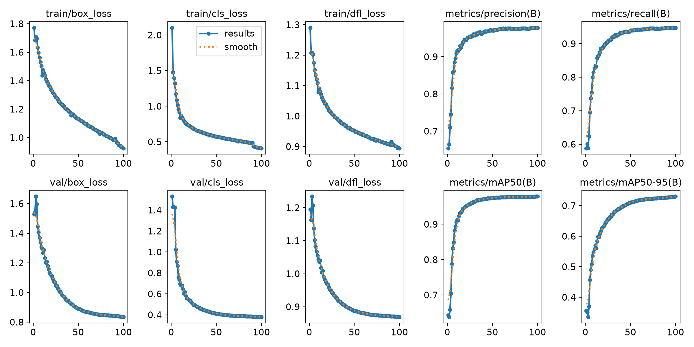
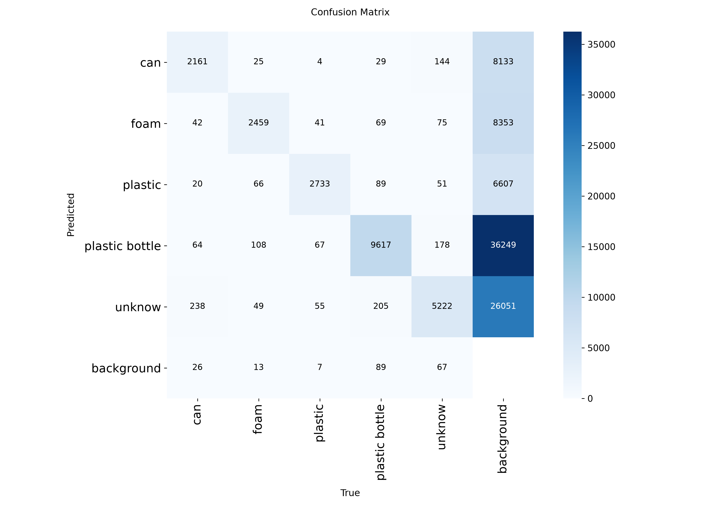
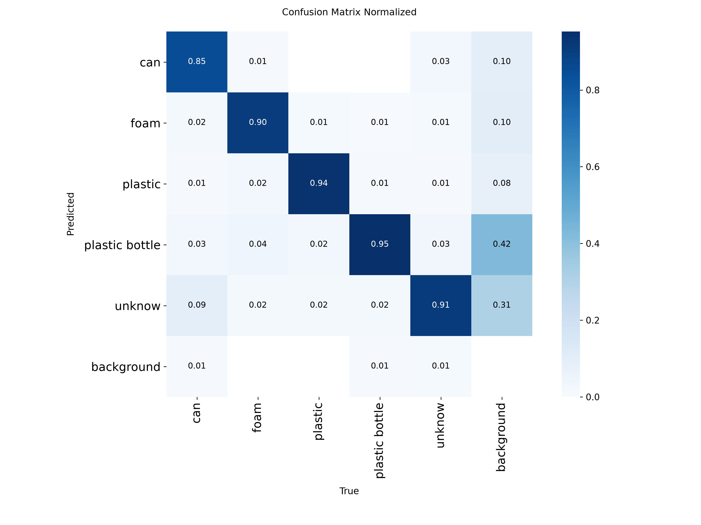
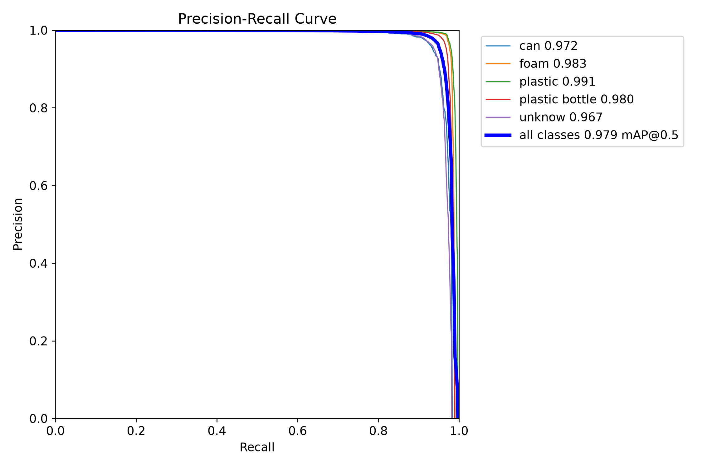
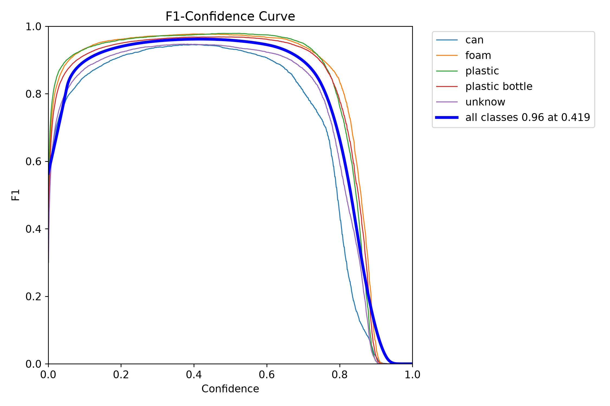
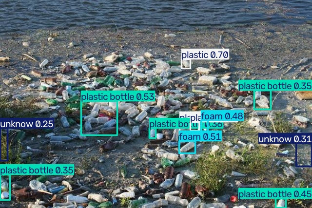
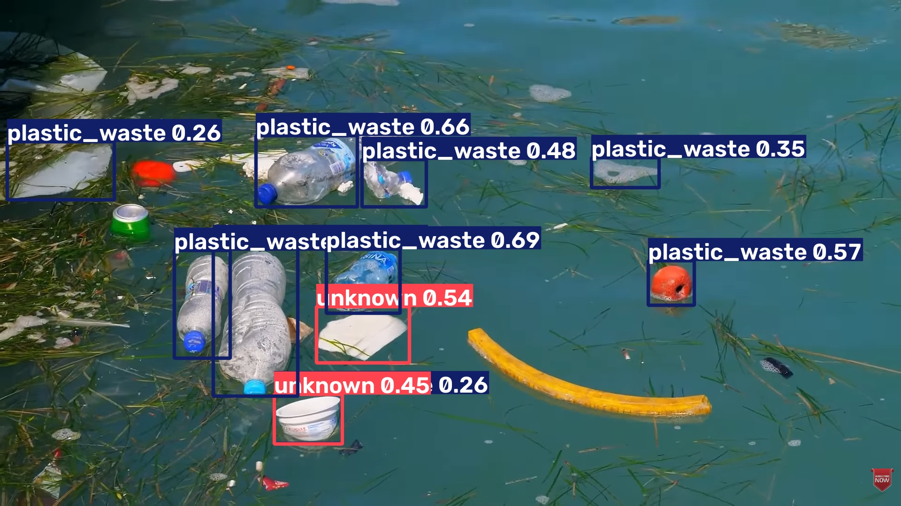
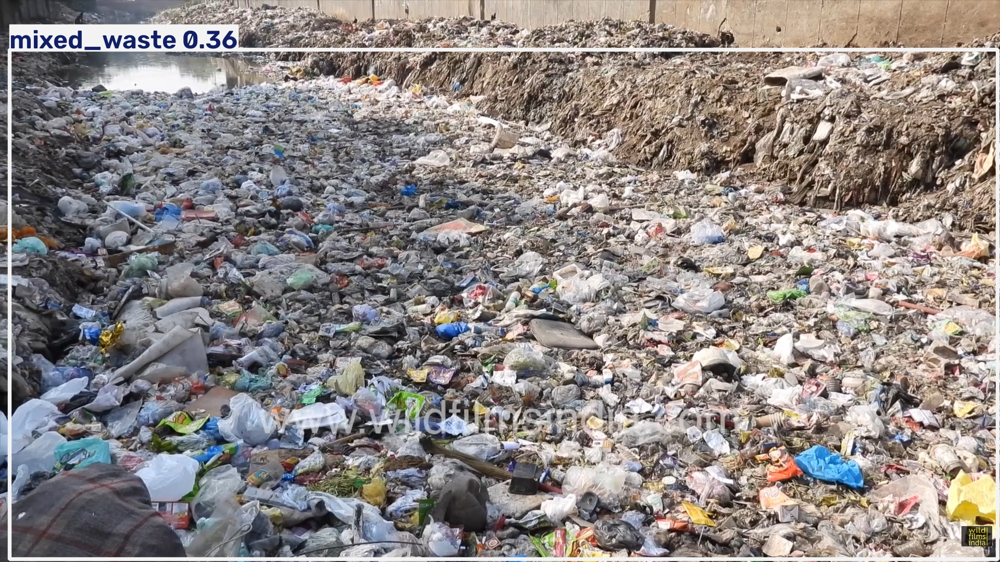
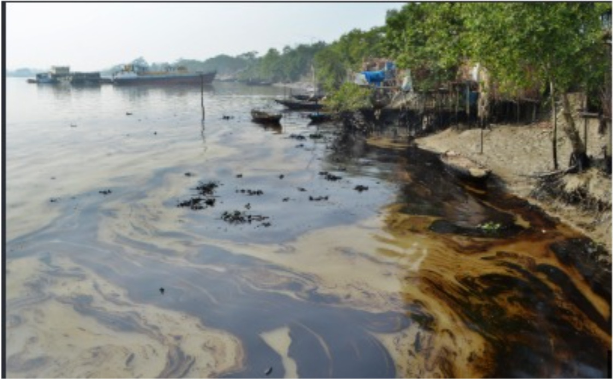
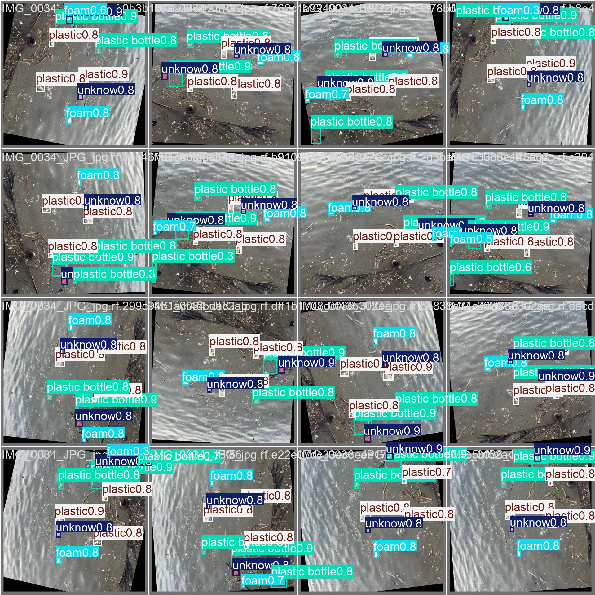

<div align="center">

# 🌊 AquaVision: AI-Powered River Surface Waste Detection
### Real-Time Aquatic Debris Detection & Classification using YOLO11n

[](LICENSE)
[](https://www.python.org/)
[](https://docs.ultralytics.com/)
[](https://pytorch.org/)
[](#9-model-evaluation-results)
[](#9-model-evaluation-results)

**AquaVision** is an end-to-end computer vision system designed to detect, locate, and classify river surface litter in real time using a lightweight, high-speed **YOLO11n** architecture. Engineered for edge deployments on autonomous river-skimmer boats (ASVs), drones (UAVs), and static riverbank surveillance stations.

---

[Overview](#1-project-overview) •
[Key Results](#9-model-evaluation-results) •
[Visualizations](#10-graphs--evaluation-visualizations) •
[Installation](#11-installation-instructions) •
[Quickstart](#12-how-to-run-image-predictions) •
[Architecture](#7-yolo11n-architecture-overview) •
[Docs](docs/)

---

</div>

## 1. Project Overview

River plastic transport represents one of the largest contributors to oceanic marine pollution. Surface floating waste—dominated by single-use beverage containers, expanded polystyrene foam, and plastic wrappings—travels through inland river channels before discharging into coastal marine ecosystems.

Traditional monitoring methods rely on manual physical surveys or reactive barrier cleanups, which are labor-intensive, hazardous, and lack spatial coverage. **AquaVision** automates surface waste tracking through deep learning, detecting multi-scale debris against challenging aquatic visual conditions such as water glares, specular reflections, ripple distortions, and turbid water currents.

---

## 2. Problem Statement

Aquatic surface object detection presents unique computer vision challenges:
- **Reflective & Moving Backgrounds**: Flowing river surfaces produce dynamic waves, specular sunlight glints, and fluctuating lighting conditions.
- **Semi-Submerged Debris**: Waterlogged waste and translucent plastic bags frequently float partially beneath the water surface, causing fragmented visual features.
- **Scale Variance**: Floating debris ranges from tiny caps (< 3 cm) to large discarded polythene sacks (> 1 m).
- **Edge Compute Constraints**: Environmental deployment on solar-powered river drones and skimmer boats requires high frame rates (30+ FPS) on low-power hardware.

AquaVision solves these challenges with a customized, lightweight **YOLO11n** neural network optimized for accuracy and low-latency inference.

---

## 3. Project Objectives

- 🎯 **Real-Time Detection**: Maintain 30+ FPS inference on edge accelerators and standard GPUs.
- 🎯 **High Accuracy**: Achieve >95% precision and recall on floating river litter to minimize false alarms.
- 🎯 **Multi-Class Granularity**: Distinguish between rigid plastic containers, film plastics, expanded foam, and metal cans.
- 🎯 **Edge Deployability**: Maintain a compact model size (< 6 MB weights) suitable for microcontrollers, Jetson boards, and embedded systems.
- 🎯 **Modular Architecture**: Provide plug-and-play CLI scripts for single images, directory batches, video files, and live webcam feeds.

---

## 4. Detection Classes & Taxonomy

AquaVision is trained on 5 discrete classes verified from the project configuration (`data.yaml`):

| Class ID | Class Name | Category | Real-World Examples |
|:---:|:---|:---|:---|
| `0` | **`can`** | Metal waste | Aluminum beverage cans, tin food cans, metal canisters |
| `1` | **`foam`** | Expanded polymer | Polystyrene packaging, thermocol blocks, cup fragments |
| `2` | **`plastic`** | Film & flexible plastics | Polythene carry bags, snack wrappers, packaging film, sacks |
| `3` | **`plastic bottle`** | Rigid containers | Clear and colored PET beverage bottles, detergent flasks |
| `4` | **`unknow`** | Miscellaneous debris | Partially submerged debris, degraded materials, unclassified litter |

> **Note on Class Configuration**:
> In real river environments, distinguishing rigid PET containers (`plastic bottle`) from flexible film (`plastic`) is crucial for sorting mechanisms in automated river skimmers. The `unknow` class ensures that degraded or anomalous floating debris is still flagged for collection without degrading the confidence of primary classes.

---

## 5. Dataset Information

The training dataset aggregates curated imagery from multiple domains to ensure field robustness:

```
Total Source Images: ~10,000 raw frames
Augmented Dataset  : 18,635 images (with 2x multi-condition augmentations)
Annotations Format : YOLOv11 normalized bounding box coordinates
```

### Dataset Sources
1. **Roboflow Universe**: Primary aquatic surface waste dataset (`aqua-vision-0whs7 / plastic_waste-tqfvh`).
2. **Kaggle Water Surface Litter Collections**: Multi-angle, open-water river imagery across variable lighting.
3. **Custom Field Samples**: Local river bank footage capturing silted water, floating vegetation, and shadows.

### Preprocessing & Data Augmentation Pipeline
- **Auto-Orientation**: Normalized EXIF sensor tags to prevent rotation skew.
- **Fit-Within Rescaling**: Standardized to $640 \times 640$ pixels preserving aspect ratios.
- **Rotational Perturbation**: Random rotations between $-10^\circ$ and $+10^\circ$ to simulate river current tumbling.
- **Photometric Jitter**: Brightness adjustments ($\pm 15\%$) and exposure variations ($\pm 10\%$) to simulate direct overhead sun, overcast skies, and riverbank canopy shade.
- **Mosaic Augmentation**: 4-image mosaic compositing during training (closed in final 10 epochs for contour stabilization).

---

## 6. Technology Stack

- **Deep Learning Framework**: [PyTorch 2.x](https://pytorch.org/) (CUDA 12.x enabled)
- **Object Detection Architecture**: [Ultralytics YOLO11n](https://github.com/ultralytics/ultralytics) (Nano variant)
- **Computer Vision & Image Processing**: [OpenCV 4.x](https://opencv.org/)
- **Data & Numerical Operations**: [NumPy](https://numpy.org/), [Polars](https://pola.rs/), [PyYAML](https://pyyaml.org/)
- **Plotting & Analytics**: [Matplotlib](https://matplotlib.org/), [Pillow](https://python-pillow.org/)
- **Target OS**: Windows 10/11, Linux (Ubuntu 20.04/22.04), Embedded Linux (NVIDIA Jetpack)

---

## 7. YOLO11n Architecture Overview

AquaVision is powered by the **YOLO11n (Nano)** model—Ultralytics' latest vision architecture combining extreme computational efficiency with high representational capacity.

```
       [ Input: 640x640x3 RGB Image ]
                     │
                     ▼
  ┌─────────────────────────────────────┐
  │       BACKBONE (Feature Extractor)  │
  │  - Stem Convolution (3x3, stride 2) │
  │  - C3k2 Blocks (dynamic bottlenecks)│
  │  - SPPF (Spatial Pyramid Pooling)   │
  └──────────────────┬──────────────────┘
                     │ Multi-scale feature maps (P3, P4, P5)
                     ▼
  ┌─────────────────────────────────────┐
  │         NECK (Feature Fusion)       │
  │  - Top-down Feature Pyramid (FPN)   │
  │  - Bottom-up Path Aggregation (PAN) │
  │  - C2PSA Spatial Attention Modules  │
  └──────────────────┬──────────────────┘
                     │ Enriched multi-scale pyramids
                     ▼
  ┌─────────────────────────────────────┐
  │      DECOUPLED DETECTION HEAD       │
  │  - Anchor-Free Task Aligner         │
  │  - Classification Head (BCE Loss)   │
  │  - Regression Head (CIoU + DFL Loss)│
  └──────────────────┬──────────────────┘
                     │
                     ▼
  [ Output: Bounding Boxes + Confidence + Class Scores ]
```

### Key Architectural Advantages
1. **C3k2 Blocks**: Cross Stage Partial blocks with dual convolutions improve feature reusability across shallow and deep layers while avoiding gradient degradation.
2. **C2PSA Spatial Attention**: Selectively attends to high-salience floating targets while discarding repetitive background water ripples and reflections.
3. **Decoupled Anchor-Free Head**: Classifies debris and regresses bounding box coordinates along separate computational paths, resolving optimization conflicts.
4. **Footprint**:
   - Total Parameters: **~2.6 Million**
   - Model Weight File: **5.48 MB** (`weights/best.pt`)
   - Computational Complexity: **~6.5 GFLOPs**

---

## 8. Training Methodology

The model was trained for **100 epochs** using transfer learning initialized from COCO-pretrained weights:

| Parameter | Value | Description |
|---|---|---|
| **Base Architecture** | `yolo11n.pt` | Ultralytics YOLO11 Nano pretrained checkpoint |
| **Epochs** | `100` | Full convergence schedule |
| **Batch Size** | `16` | Optimized for GPU memory throughput |
| **Input Image Size** | `640 × 640` | Standard multi-scale resolution |
| **Optimizer** | `MuSGD` | Momentum SGD with adaptive parameter grouping |
| **Initial Learning Rate ($\text{lr}_0$)** | `0.01` | Warmup schedule over first 3 epochs |
| **Final Learning Rate ($\text{lr}_f$)** | `0.01` | Linear / cosine decay |
| **Momentum** | `0.937` | Gradient momentum |
| **Weight Decay** | `0.0005` | $L_2$ regularization penalty |
| **AMP (Mixed Precision)** | `Enabled (FP16)` | Accelerates training and halves memory footprint |
| **Close Mosaic** | `10` | Mosaic augmentation disabled in epochs 91–100 |

---

## 9. Model Evaluation Results

AquaVision achieved outstanding detection performance on the held-out validation set:

| Evaluation Metric | Score (Percentage) | Score (Decimal) |
|---|:---:|:---:|
| **Precision** | **97.74%** | `0.9774` |
| **Recall** | **94.83%** | `0.9483` |
| **mAP@50 (IoU = 0.50)** | **97.88%** | `0.9788` |
| **mAP@50-95 (IoU = 0.50:0.95)** | **73.06%** | `0.7306` |
| **F1 Score** | **96.27%** | `0.9627` |

$$\text{F1 Score} = 2 \times \frac{\text{Precision} \times \text{Recall}}{\text{Precision} + \text{Recall}} = 2 \times \frac{0.9774 \times 0.9483}{0.9774 + 0.9483} = \mathbf{96.27\%}$$

For comprehensive per-class breakdowns, loss curves, and analysis, see the [Performance Metrics Document](evaluation/performance_metrics.md).

---

## 10. Graphs & Evaluation Visualizations

The evaluation figures generated during model validation demonstrate high stability and rapid convergence:

### 10.1 Training & Metric Curves (`results.png`)
Across 100 epochs, training losses (Box Loss, Class Loss, DFL Loss) declined smoothly while validation mAP@50 stabilized above 97%:

<div align="center">
  
</div>

---

### 10.2 Confusion Matrix
The confusion matrix confirms near-zero false positive rates on the river background and sharp diagonal classification purity:

<div align="center">
  
  
</div>

---

### 10.3 Precision-Recall & F1-Confidence Curves
The PR curve maintains an area under the curve (AUC) approaching unity across all primary waste classes:

<div align="center">
  
  
</div>

---

## 11. Installation Instructions

### Prerequisites
- **Operating System**: Windows 10/11, Ubuntu 20.04+, or macOS
- **Python**: Version 3.10, 3.11, or 3.12
- **CUDA** *(Optional, recommended for GPU acceleration)*: NVIDIA Driver + CUDA 11.8 or 12.x

### Step-by-Step Setup (Windows / PowerShell)

1. **Clone the Repository**:
   ```powershell
   git clone https://github.com/pratikrahane01/Aquavision.git
   cd Aquavision
   ```

2. **Create and Activate a Virtual Environment**:
   ```powershell
   python -m venv venv
   .\venv\Scripts\Activate.ps1
   ```
   *(On Linux/macOS: `source venv/bin/activate`)*

3. **Install Dependencies**:
   ```powershell
   pip install --upgrade pip
   pip install -r requirements.txt
   ```

4. **Verify PyTorch CUDA Support (Optional)**:
   ```powershell
   python -c "import torch; print('CUDA Available:', torch.cuda.is_available())"
   ```

5. **Verify Model Weights**:
   Confirm that the trained model file is present at `weights/best.pt` (~5.5 MB).

---

## 12. How to Run Image Predictions

Use `src/detect_image.py` or the unified `src/predict.py` to detect river waste on images:

### Single Image Detection
```powershell
python src/detect_image.py --source "sample_outputs/images/sample_prediction_1.jpg" --conf 0.25
```

### Directory of Images (Batch Inference)
```powershell
python src/detect_image.py --source "path/to/image_folder" --output "sample_outputs/images" --conf 0.30
```

### Display Detections Interactively
```powershell
python src/detect_image.py --source "sample_outputs/images/sample_prediction_1.jpg" --show
```

---

## 13. How to Run Video Predictions

Use `src/detect_video.py` for real-time video stream processing with FPS monitoring:

### Real-Time Live Webcam Detection
```powershell
python src/detect_video.py --source 0 --conf 0.25
```

### Video File Detection and Export
```powershell
python src/detect_video.py --source "path/to/river_video.mp4" --output "sample_outputs/videos/annotated_river.mp4" --conf 0.25
```

*Press `q` at any time to safely exit video detection.*

---

## 14. Example Prediction Outputs

Below are actual detection outputs produced by the AquaVision YOLO11n model:

### 14.1 Detection on River Surface Waste
Dense litter cluster containing rigid bottles, thin film plastics, and polystyrene foam correctly identified and bounded:

<div align="center">
  
</div>

---

### 14.2 High-Confidence Multi-Class River Litter Detections

<div align="center">
  
  
</div>

<div align="center">
  
  
</div>

---

## 15. Project Limitations

While AquaVision demonstrates exceptional performance on surface litter, users should note the following environmental constraints:
1. **Sub-surface & Waterlogged Waste**: Debris floating deeper than 30–50 cm below the surface is prone to severe light refraction and water absorption, leading to lower detection confidence.
2. **Extreme Surface Glare**: Severe direct sunlight specular reflections off fast rapids can occasionally obscure small bottle caps or thin translucent film.
3. **Severe Weed / Algae Entanglement**: Litter heavily enveloped by thick river hyacinth or algae mats may only be detected as `unknow` or missed if visual features are >70% occluded.

---

## 16. Future Scope & Roadmap

- [ ] **Autonomous Surface Vessel (ASV) Integration**: Mount AquaVision on solar-powered trash collector catamarans with ROS2 integration.
- [ ] **Edge Hardware Acceleration**: Export weights to **TensorRT INT8** and **ONNX** for ultra-low power execution on NVIDIA Jetson Orin Nano (60+ FPS at < 10W).
- [ ] **Multi-Camera Stereo Depth Estimation**: Combine bounding boxes with stereo vision depth maps to compute 3D GPS coordinates of floating debris for robotic arm collection.
- [ ] **IoT River Telemetry**: Implement cellular/LoRaWAN modules to transmit automated litter density heatmaps to municipal river protection authorities.
- [ ] **Debris Segmentation**: Extend from bounding-box detection to instance segmentation (`yolo11n-seg`) to estimate volume and mass of collected waste.

---

## 17. Repository Structure

```text
AquaVision/
├── weights/
│   └── best.pt                     # Trained YOLO11n model weights (~5.5 MB)
│
├── src/
│   ├── __init__.py                 # Package initializer
│   ├── predict.py                  # Unified CLI prediction interface
│   ├── detect_image.py             # Image & folder inference script
│   ├── detect_video.py             # Video file & webcam real-time stream script
│   ├── evaluate.py                 # Validation metrics evaluation script
│   └── utils.py                    # Visualizations & model loader utilities
│
├── evaluation/
│   ├── confusion_matrix.png        # Confusion matrix
│   ├── confusion_matrix_normalized.png # Normalized confusion matrix
│   ├── results.png                 # Loss curves and mAP progression over 100 epochs
│   ├── PR_curve.png                # Precision-Recall curve
│   ├── F1_curve.png                # F1 Score vs Confidence curve
│   ├── results.csv                 # Raw epoch-by-epoch training log
│   └── performance_metrics.md      # Detailed metrics breakdown and analysis
│
├── sample_outputs/
│   └── images/                     # Real project prediction output samples
│       ├── sample_prediction_1.jpg
│       ├── sample_prediction_2.jpg
│       ├── sample_prediction_3.jpg
│       ├── sample_prediction_4.jpg
│       └── val_batch_predictions.jpg
│
├── docs/
│   ├── methodology.md              # Engineering methodology & pipeline details
│   └── model_architecture.md       # YOLO11n architectural deep-dive
│
├── data.yaml                       # Dataset configuration & class taxonomy
├── requirements.txt                # Python environment dependencies
├── README.md                       # Comprehensive project documentation
├── .gitignore                      # Git exclusion rules
└── LICENSE                         # Apache 2.0 License & third-party notices
```

---

## 18. License & Acknowledgements

### License
This project is licensed under the **Apache License 2.0** - see the [LICENSE](LICENSE) file for complete details.

### Third-Party Notices & Attribution
- **Ultralytics YOLO**: The underlying YOLO11 architecture and training framework are developed by [Ultralytics Inc.](https://github.com/ultralytics/ultralytics) and licensed under the GNU Affero General Public License v3.0 (AGPL-3.0) or commercial enterprise license.
- **Dataset Attribution**: Public dataset annotations are sourced from the [Roboflow Universe](https://universe.roboflow.com/aqua-vision-0whs7/plastic_waste-tqfvh/dataset/1) community under [CC BY 4.0](https://creativecommons.org/licenses/by/4.0/).
- Special thanks to the open-source computer vision research community and environmental conservation datasets that made this project possible.

---

<div align="center">
  <b>Developed by Pratik Rahane</b><br>
  <i>AquaVision - AI for Cleaner Rivers & Sustainable Water Bodies</i>
</div>
